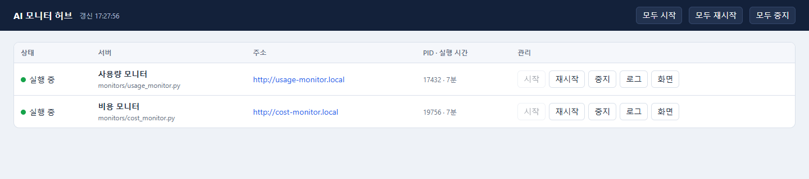
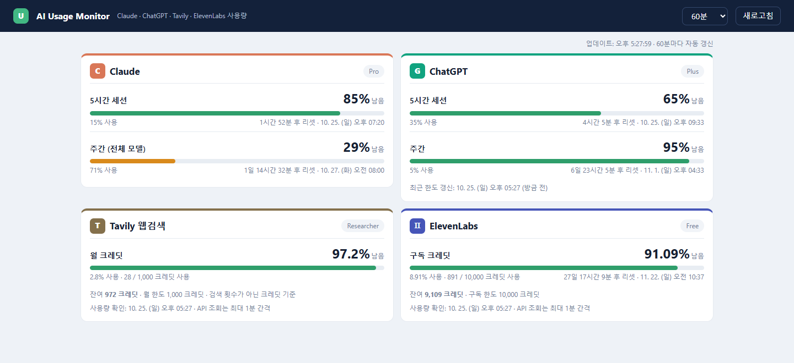
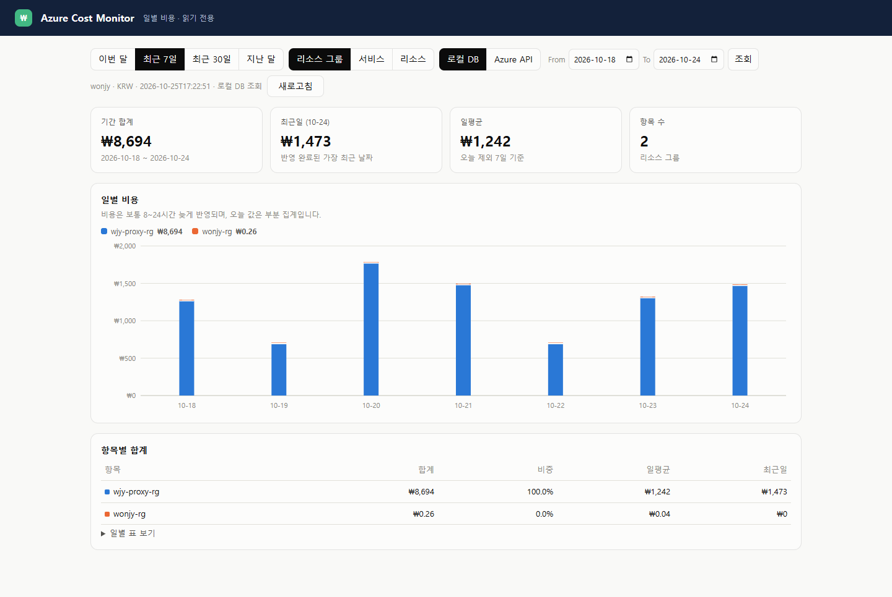
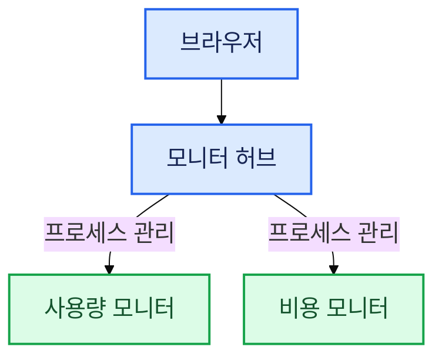
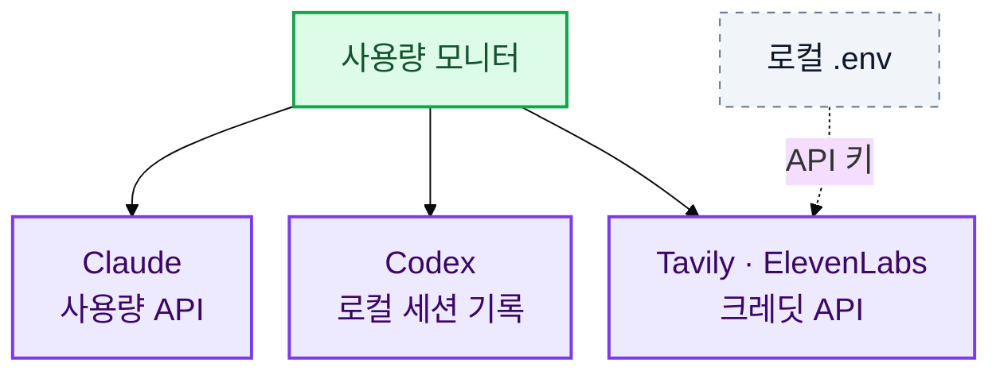
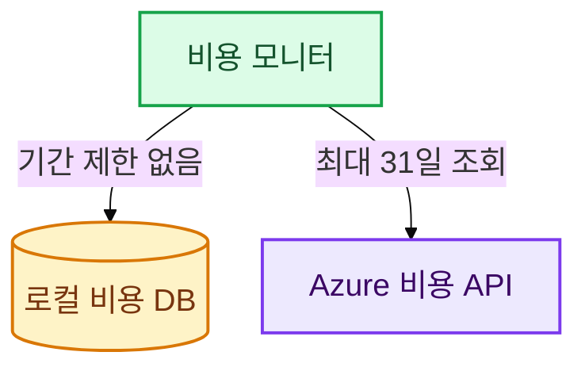
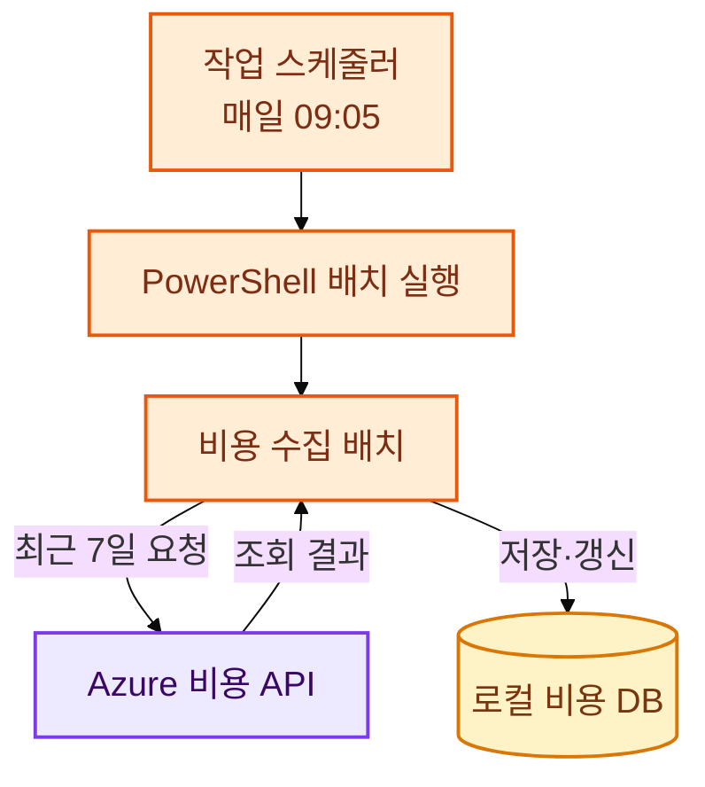

# AI Monitor

Claude·Codex 구독 한도, Tavily·ElevenLabs 크레딧과 Azure 비용을 확인하는 로컬 모니터입니다. 대시보드와 비용 수집 배치를 관리합니다.

허브에서 사용량·비용 모니터를 실행하고 관리합니다.

## 목차

- [1. 사전 조건](#1-사전-조건)
- [2. 빠른 시작](#2-빠른-시작)
  - [2.1. 비용 DB 최초 생성·수집](#21-비용-db-최초-생성수집)
  - [2.2. 화면 주소](#22-화면-주소)
  - [2.3. Windows에서 VS Code 없이 실행](#23-windows에서-vs-code-없이-실행)
- [3. 실제 화면](#3-실제-화면)
  - [3.1. 모니터 허브](#31-모니터-허브)
  - [3.2. 사용량 모니터](#32-사용량-모니터)
  - [3.3. Azure 비용 모니터](#33-azure-비용-모니터)
- [4. 구조와 데이터 흐름](#4-구조와-데이터-흐름)
  - [4.1. 허브와 모니터](#41-허브와-모니터)
  - [4.2. 사용량 조회](#42-사용량-조회)
  - [4.3. 비용 화면 조회](#43-비용-화면-조회)
  - [4.4. 예약 배치 수집](#44-예약-배치-수집)
  - [4.5. 폴더 구조](#45-폴더-구조)
- [5. 비용 배치 — 매일 09:05](#5-비용-배치--매일-0905)
- [6. 검증과 화면 캡처](#6-검증과-화면-캡처)
- [7. 보안과 Git 업로드](#7-보안과-git-업로드)

## 1. 사전 조건

필요한 기능만 준비하면 됩니다. 허브·사용량 화면 자체는 비용 DB 없이 실행할 수 있지만, Azure 비용 서버와 로컬 비용 조회에는 아래 조건이 추가로 필요합니다.

| 대상 | 사전 조건 | 준비되지 않은 경우 |
|---|---|---|
| 공통 실행 | Windows PowerShell, Python 3.10 이상, 저장소·`logs/` 쓰기 권한 | 서버 실행 또는 로그 저장 실패 |
| Claude 사용량 | Claude Code 로그인, 유효한 `~/.claude/.credentials.json`, API 인터넷 연결 | Claude 카드에 인증·연결 오류 표시 |
| Codex 한도 | Codex 사용 후 `~/.codex/sessions`에 한도 기록 생성 | 표시할 한도 정보가 없거나 이전 기록 표시 |
| Tavily·ElevenLabs | 루트 `.env`의 해당 API 키, API 인터넷 연결. ElevenLabs는 `user_read` 권한 | 해당 카드에 설정·권한 오류 표시 |
| Azure 비용 서버 | Azure CLI 설치·로그인, 조회할 구독 선택 | **로컬 DB 조회를 선택해도**, 서버 시작 시 `az account show`에 실패하면 비용 서버 실행 불가 |
| Azure API 조회·배치 수집 | 대상 구독 비용 조회 권한(Cost Management Reader 등), Azure API 연결 | 직접 조회·DB 수집 실패 |
| 로컬 DB 조회 | `data/cost_monitor.db`에 선택한 구독·분류·기간의 수집 데이터 | 파일이 없거나 수집 범위가 부족하면 조회할 비용 없음 |
| 예약 배치 | 작업 스케줄러에 별도 등록, 실행 사용자 Azure 로그인 유지, 실행 시 시스템 전원 켜짐 | 정해진 시각에 수집되지 않음 |

**DB 서버 설치는 필요 없습니다.** Python에 포함된 SQLite를 사용합니다. DB 파일·테이블은 최초 배치 실행 시 자동 생성되지만, 비용 데이터는 Azure 조회에 성공해야 채워집니다. Git에는 DB와 실제 인증 정보가 포함되지 않습니다.

`~`는 서버를 실행하는 Windows 사용자의 홈 폴더입니다. 다른 사용자로 실행하면 Claude·Codex 기록과 Azure CLI 로그인 정보가 달라질 수 있습니다. 포트 없는 `.local` 주소를 사용하려면 아래 hosts 설정도 필요합니다.

## 2. 빠른 시작

Windows PowerShell에서 저장소 루트로 이동합니다. Python 3.10 이상이 필요하며, 서버 자체는 Python 표준 라이브러리만 사용합니다.

```powershell
cd F:\sandbox\ai-monitor
# 기존 .env는 덮어쓰지 않습니다.
if (-not (Test-Path .env)) { Copy-Item .env.example .env }
# 필요한 항목을 .env에 입력한 뒤 실행합니다.
python hub.py --start-all
```

### 2.3. Windows에서 VS Code 없이 실행

VS Code를 열지 않고도 프로젝트 폴더의 `run-hub.bat`을 더블클릭해 허브를 실행할 수 있습니다.

```powershell
cd F:\sandbox\ai-monitor
.\run-hub.bat
```

실행 옵션은 배치 파일 뒤에 그대로 전달됩니다.

```powershell
.\run-hub.bat --start-all
.\run-hub.bat --restart-all
.\run-hub.bat --no-browser
```

`hub.py`가 실행되면 기존 AI Monitor 서버 프로세스를 정리하고 허브를 시작합니다. Chrome은 AI Monitor 전용 프로필로 일반 Chrome 창을 열며, 다음 실행 시 이전 전용 창만 닫습니다. 기존 개인 Chrome 창과 탭은 건드리지 않습니다. 전용 프로필은 `%LOCALAPPDATA%\ai-monitor\chrome-profile`에 저장됩니다.

앱 실행에는 Python 표준 라이브러리만 필요합니다. `tests/requirements.txt`의 `playwright`는 브라우저 테스트와 화면 캡처용 의존성입니다.

새 저장소에는 인증 정보와 비용 DB가 없습니다. 아래 설정을 완료해야 각 서비스의 실제 수치가 표시됩니다.

| 기능 | 준비할 항목 |
|---|---|
| Claude 사용량 | Claude Code 로그인 정보 `~/.claude/.credentials.json` |
| Codex 한도 | `~/.codex/sessions`에 기록된 한도 정보 |
| Tavily 크레딧 | 루트 `.env`의 `TAVILY_API_KEY` |
| ElevenLabs 크레딧 | 루트 `.env`의 `ELEVENLABS_API_KEY`, 구독 조회에 필요한 `user_read` 권한 |
| Azure 비용 | Azure CLI 설치·`az login`, 대상 구독의 Cost Management Reader 이상 권한 |

### 2.1. 비용 DB 최초 생성·수집

아래 명령은 DB가 없으면 생성하고 Azure 조회 결과를 `data/cost_monitor.db`에 저장합니다. 기본 화면은 어제까지의 최근 7일을 표시하므로, 최초에는 오늘을 포함한 **8일**을 수집해 그 범위를 채웁니다.

```powershell
az login
# 구독이 여러 개라면 대상 구독으로 변경합니다.
az account set --subscription "구독 이름 또는 ID"
python -m monitors.cost_batch --days 8
# 수집 성공 후 비용 화면을 새로고침합니다.
```

이미 DB가 있으면 다시 만들 필요는 없습니다. 배치를 재실행하면 해당 구독·날짜·항목의 비용을 갱신합니다. 수집과 화면 조회는 같은 구독을 사용해야 합니다. 더 오래된 기간이 필요하면 다음과 같이 수집 시작일을 지정합니다.

```powershell
python -m monitors.cost_batch --from-date 2026-10-01
# 파일 존재 여부만 확인 (수집 성공 여부는 배치 출력·화면도 확인)
Test-Path .\data\cost_monitor.db
```

기존 DB를 옮길 때는 관련 서버·배치를 중지하고 `data/cost_monitor.db` 위치에 복사합니다. 이 프로젝트가 생성한 테이블 구조의 DB를 사용해야 하며, 공유·백업 시 비용·구독 정보의 공개 범위에 주의하세요.

### 2.2. 화면 주소

| 화면 | hosts 등록 시 | hosts 미등록 시 |
|---|---|---|
| 모니터 허브 | http://ai-monitor.local | http://127.0.0.1:8770 |
| 사용량 모니터 | http://usage-monitor.local | http://127.0.0.1:8767 |
| Azure 비용 모니터 | http://cost-monitor.local | http://127.0.0.1:8769 |

포트 없는 주소를 쓰려면 관리자 권한으로 `C:\Windows\System32\drivers\etc\hosts`에 아래 내용을 추가하고 `ipconfig /flushdns`를 실행합니다.

```text
127.0.87.67 usage-monitor.local
127.0.87.69 cost-monitor.local
127.0.87.70 ai-monitor.local
```

서버는 이 hosts 매핑을 읽어 각각의 루프백 IP·80 포트에서 실행됩니다. 매핑이 없으면 위의 기본 포트를 사용합니다. `127.0.0.1`로 이름만 매핑한 경우에도 기본 포트가 필요합니다. 기본 구성은 로컬 접속용이며 LAN 공개가 필요하지 않습니다.

## 3. 실제 화면

2026-10-25 실행 중인 서버를 Chrome으로 캡처한 화면입니다. 테스트용 가짜 데이터가 아니며, 사용량·비용·기준 시각은 캡처 시점의 값입니다.

### 3.1. 모니터 허브

서버 상태·PID를 확인하고 시작·중지·재시작, 로그 및 화면 보기를 수행합니다.



### 3.2. 사용량 모니터

Claude, ChatGPT/Codex, Tavily, ElevenLabs 네 카드를 한 화면에 표시합니다. 로컬 기록 기준 토큰 사용량 표는 표시하지 않습니다.



- 막대 길이는 **잔여량**입니다. 93% 남았으면 막대도 93% 채웁니다.
- 막대 색상도 **잔여량** 기준으로 읽으면 됩니다: 30% 초과 초록, 10% 초과·30% 이하 주황, 10% 이하 빨강.
- 화면 자동 갱신은 기본 60분이며, 선택 상자에서 변경하거나 수동 새로고침할 수 있습니다.
- Tavily·ElevenLabs 조회 결과는 1분간 재사용하며, 이후 화면을 갱신할 때 다시 조회합니다.
- Codex 한도는 세션에 마지막으로 기록된 값입니다. 화면 새로고침만으로 서비스의 실시간 한도를 직접 조회하지는 않습니다.
- Claude 인증 토큰도 모니터가 자체 갱신하지 않습니다. 만료 시 Claude Code를 실행해 갱신한 뒤 다시 조회합니다.

### 3.3. Azure 비용 모니터

로컬 DB와 Azure API 조회를 전환하고 리소스 그룹·서비스·리소스별로 비용을 확인합니다.



- **로컬 DB**: 조회 기간 제한 없음. 실제로 수집된 날짜 범위까지만 표시합니다.
- **Azure API**: 시작일·종료일을 모두 포함해 최대 **31일**. 화면과 서버 모두 검사합니다.
- 일별 상세 표는 날짜·합계·항목·비용의 네 컬럼입니다.
- Azure 반영 지연이나 당일 부분 집계 때문에 최근 날짜의 비용은 재수집하면 바뀔 수 있습니다.

## 4. 구조와 데이터 흐름

허브는 두 서버의 프로세스를 관리합니다. 사용량·비용 데이터는 각 모니터가 직접 조회합니다.

### 4.1. 허브와 모니터

허브가 사용량·비용 서버를 각각 실행·중지·재시작합니다.



진입점: `hub.py` → `monitors.usage_monitor` / `monitors.cost_monitor`.

### 4.2. 사용량 조회

사용량 모니터가 각 서비스의 한도·크레딧을 모아 표시합니다.



Claude는 로컬 로그인 정보를 사용하고, Codex는 로컬 세션에 기록된 한도를 읽습니다. Tavily·ElevenLabs 조회 코드는 `providers/`에 있으며 키는 Git에서 제외된 루트 `.env`에서 읽습니다.

### 4.3. 비용 화면 조회

로컬 DB와 Azure API 중 선택한 경로로 비용을 조회합니다.



비용 화면: `monitors.cost_monitor`. 로컬 DB: `data/cost_monitor.db`.

### 4.4. 예약 배치 수집

매일 09:05에 최근 7일을 재수집해 로컬 DB를 갱신합니다.



실행 스크립트: `scripts/run_cost_batch.ps1` → `monitors.cost_batch`. 저장 위치는 비용 화면에서 읽는 DB와 같습니다.

색상: 파랑은 브라우저·허브, 초록은 모니터, 보라는 조회 대상, 노랑은 DB, 주황은 예약·배치, 회색 점선은 로컬 설정입니다.

### 4.5. 폴더 구조

```text
ai-monitor/
├── hub.py                    # 허브 진입점
├── monitors/                 # 사용량·비용 서버와 비용 수집 배치
├── common/                   # 공통 웹서버·파비콘·프로젝트 경로
├── providers/                # Tavily·ElevenLabs 사용량 조회
├── scripts/                  # 배치 실행·Git 업로드·화면 캡처
├── tests/                    # 단위 테스트·브라우저 검증
├── docs/images/              # README용 실제 화면 캡처
├── data/                     # 로컬 비용 DB (Git 제외)
├── logs/                     # 실행 로그 (Git 제외)
├── .env                      # 실제 설정·키 (Git 제외)
└── .env.example              # 공개용 설정 양식
```

기존 루트의 `webserver.py`는 `common/server.py`로 옮겼습니다. 개별 모니터는 파일 경로 대신 **저장소 루트에서 모듈로 실행**합니다. `.env`는 루트 한 곳에서 읽습니다.

```powershell
python hub.py --start-all
python hub.py --restart-all
python hub.py --no-browser
# 각각 직접 실행할 때:
python -m monitors.usage_monitor
python -m monitors.cost_monitor
python -m monitors.cost_batch --days 7
```

허브에서 실행한 모니터의 출력은 `logs/`에 저장됩니다. 허브 콘솔을 닫아도 별도로 실행된 모니터는 계속 동작할 수 있으므로, 중지할 때는 허브의 관리 버튼을 사용합니다.

## 5. 비용 배치 — 매일 09:05

현재 개발 환경에는 Windows 작업 **`AI-Monitor-CostBatch`**가 등록되어 있습니다. 매일 한국 시간 **09:05**에 최근 7일을 다시 수집해 지연 반영된 비용도 갱신합니다.

- 실행 파일: `powershell.exe`
- 인수: `-NoProfile -NonInteractive -ExecutionPolicy Bypass -File "F:\sandbox\ai-monitor\scripts\run_cost_batch.ps1"`
- 시작 위치: `F:\sandbox\ai-monitor`
- 로그: `logs/cost-batch-YYYY-MM-DD.log`
- 현재 등록은 해당 사용자 로그인 상태에서 실행합니다. 시스템이 꺼져 있으면 정시에 실행할 수 없으며, 놓친 예약은 실행 가능한 시점에 실행하도록 설정되어 있습니다.

작업 스케줄러는 저장소에 포함되지 않습니다. **다른 환경에서는 별도 등록**하고 위 경로도 실제 저장소 위치로 바꿔야 합니다. 작업 만들기에서 일일 트리거 09:05, 위 동작, “예약된 시작 시간을 놓친 경우 가능한 대로 빨리 작업 시작”을 지정합니다. Azure CLI에 로그인한 사용자로 실행하세요.

```powershell
# 작업 스케줄러 화면 열기
mmc.exe "$env:WINDIR\System32\taskschd.msc"
# 등록 상태·최근 결과 확인
Get-ScheduledTask -TaskName AI-Monitor-CostBatch
Get-ScheduledTaskInfo -TaskName AI-Monitor-CostBatch
# 지금 다시 실행
Start-ScheduledTask -TaskName AI-Monitor-CostBatch
# 예약과 관계없이 직접 실행
.\scripts\run_cost_batch.ps1
```

`LastTaskResult`가 `0`이면 정상 종료입니다. 인증 오류 등 세부 원인은 해당 날짜 로그에서 확인합니다.

## 6. 검증과 화면 캡처

브라우저 검증·캡처에는 Playwright와 설치된 Google Chrome이 필요합니다. 먼저 서버를 실행합니다.

```powershell
python -m pip install -r tests/requirements.txt
python -m unittest discover -s tests -v
python -m tests.test_cost_web
python -m tests.test_usage_web
# 위 hosts 주소가 설정된 환경에서 실제 화면 다시 캡처:
python -m scripts.capture_screenshots
# 선택 사항: 정적 타입 검사 (Node.js·npx 필요)
npx --yes pyright monitors providers common hub.py
```

캡처 스크립트는 화면의 로딩 완료를 기다린 뒤 `docs/images/`의 PNG 세 장을 갱신합니다. Git에 올리기 전 계정·리소스 이름 등 공개 범위도 확인하세요. 브라우저 테스트의 가짜 응답 기반 검증 화면과 README의 실제 캡처는 별개입니다.

## 7. 보안과 Git 업로드

`.env`, 인증 파일, Azure 로그인 캐시, 비용 DB, 로그는 Git에서 제외합니다. `.env.example`에는 실제 키·내부 엔드포인트가 아닌 자리표시자만 둡니다. 인증 파일과 API 키를 문서나 화면 캡처에 넣지 마세요.

변경 내용을 확인한 뒤 다음 명령으로 업로드할 수 있습니다. 민감정보를 과거 커밋에 올렸다면 파일 삭제만으로 해결되지 않으며, 키 폐기·재발급과 별도 이력 정리가 필요합니다.

```powershell
.\scripts\git_push.ps1 -Message "변경 내용"
```
