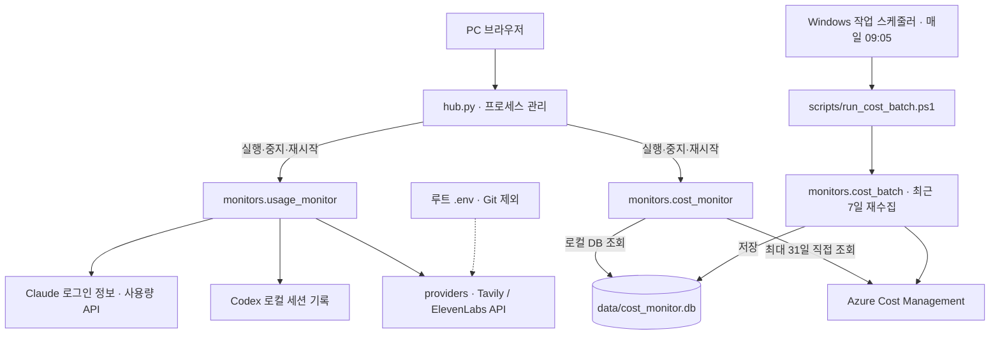

# AI Monitor

Claude·Codex 구독 한도, Tavily·ElevenLabs 크레딧과 Azure 비용을 확인하는 로컬 모니터입니다. PC 대시보드와 별도 Android 앱(Code Spend)을 함께 관리합니다.

- **PC**: 허브에서 사용량·비용 모니터를 실행하고 관리합니다.
- **Android**: PC 서버 없이 동작합니다. 현재 Claude는 공식 웹에서 사용량을 확인하고, Codex는 인증 파일을 가져와 앱 카드에서 조회합니다. 모바일 자체 로그인·토큰 자동 갱신은 구현되어 있지 않습니다.

## 빠른 시작 — PC

Windows PowerShell에서 저장소 루트로 이동합니다. Python 3.10 이상이 필요하며, PC 서버 자체는 Python 표준 라이브러리만 사용합니다.

```powershell
cd F:\sandbox\ai-monitor
# 기존 .env는 덮어쓰지 않습니다.
if (-not (Test-Path .env)) { Copy-Item .env.example .env }
# 필요한 항목을 .env에 입력한 뒤 실행합니다.
python hub.py --start-all
```

새 저장소에는 인증 정보와 비용 DB가 없습니다. 아래 설정을 완료해야 각 서비스의 실제 수치가 표시됩니다.

| 기능 | 준비할 항목 |
|---|---|
| Claude 사용량 | 이 PC의 Claude Code 로그인 정보 `~/.claude/.credentials.json` |
| Codex 한도 | 이 PC의 `~/.codex/sessions`에 기록된 한도 정보 |
| Tavily 크레딧 | 루트 `.env`의 `TAVILY_API_KEY` |
| ElevenLabs 크레딧 | 루트 `.env`의 `ELEVENLABS_API_KEY`, 구독 조회에 필요한 `user_read` 권한 |
| Azure 비용 | Azure CLI 설치·`az login`, 대상 구독의 Cost Management Reader 이상 권한 |

비용 DB를 처음 채우려면 다음 명령을 실행합니다. Azure 조회 결과는 `data/cost_monitor.db`에 저장됩니다.

```powershell
az login
python -m monitors.cost_batch
```

### 화면 주소

| 화면 | hosts 등록 시 | hosts 미등록 시 |
|---|---|---|
| 모니터 허브 | http://ai-monitor.local | http://127.0.0.1:8770 |
| 사용량 모니터 | http://usage-monitor.local | http://127.0.0.1:8767 |
| Azure 비용 모니터 | http://cost-monitor.local | http://127.0.0.1:8769 |

포트 없는 주소를 쓰려면 관리자 권한으로 `C:\Windows\System32\drivers\etc\hosts`에 아래 내용을 추가하고 `ipconfig /flushdns`를 실행합니다.

```text
127.0.87.67 usage-monitor.local
127.0.87.69 cost-monitor.local
127.0.87.70 ai-monitor.local
```

서버는 이 hosts 매핑을 읽어 각각의 루프백 IP·80 포트에서 실행됩니다. 매핑이 없으면 위의 기본 포트를 사용합니다. `127.0.0.1`로 이름만 매핑한 경우에도 기본 포트가 필요합니다. 기본 구성은 PC 내부 접속용이며 LAN 공개가 필요하지 않습니다.

## 실제 화면

2026-10-25 실행 중인 서버를 Chrome으로 캡처한 화면입니다. 테스트용 가짜 데이터가 아니며, 사용량·비용·기준 시각은 캡처 시점의 값입니다.

### 모니터 허브

서버 상태·PID를 확인하고 시작·중지·재시작, 로그 및 화면 보기를 수행합니다.


### 사용량 모니터

Claude, ChatGPT/Codex, Tavily, ElevenLabs 네 카드를 한 화면에 표시합니다. 로컬 기록 기준 토큰 사용량 표는 표시하지 않습니다.


- 막대 길이는 **잔여량**입니다. 93% 남았으면 막대도 93% 채웁니다.
- 색상은 기존 **사용률** 기준입니다: 70% 미만 초록, 70% 이상·90% 미만 주황, 90% 이상 빨강.
- 화면 자동 갱신은 기본 60분이며, 선택 상자에서 변경하거나 수동 새로고침할 수 있습니다.
- Tavily·ElevenLabs API 결과는 최대 1분 간격으로 조회합니다. 이는 캐시 간격이며 화면을 매분 자동 갱신한다는 뜻은 아닙니다.
- PC의 Codex 한도는 세션에 마지막으로 기록된 값입니다. 화면 새로고침만으로 서비스의 실시간 한도를 직접 조회하지는 않습니다.
- PC의 Claude 인증 토큰도 모니터가 자체 갱신하지 않습니다. 만료 시 Claude Code를 실행해 갱신한 뒤 다시 조회합니다.

### Azure 비용 모니터

로컬 DB와 Azure API 조회를 전환하고 리소스 그룹·서비스·리소스별로 비용을 확인합니다.


- **로컬 DB**: 조회 기간 제한 없음. 실제로 수집된 날짜 범위까지만 표시합니다.
- **Azure API**: 시작일·종료일을 모두 포함해 최대 **31일**. 화면과 서버 모두 검사합니다.
- 일별 상세 표는 날짜·합계·항목·비용의 네 컬럼입니다.
- Azure 반영 지연이나 당일 부분 집계 때문에 최근 날짜의 비용은 재수집하면 바뀔 수 있습니다.

## 구조와 데이터 흐름

허브는 두 서버의 프로세스를 관리합니다. 사용량·비용 데이터는 각 모니터가 직접 조회합니다.



### 폴더 구조

```text
ai-monitor/
├── hub.py                    # PC 허브 진입점
├── monitors/                 # 사용량·비용 서버와 비용 수집 배치
├── common/                   # 공통 웹서버·파비콘·프로젝트 경로
├── providers/                # Tavily·ElevenLabs 사용량 조회
├── scripts/                  # 배치 실행·Git 업로드·화면 캡처
├── tests/                    # 단위 테스트·브라우저 검증
├── docs/images/              # README용 실제 화면 캡처
├── android-app/              # Code Spend Android 소스·빌드·에뮬레이터 도구
├── data/                     # 로컬 비용 DB (Git 제외)
├── logs/                     # 실행 로그 (Git 제외)
├── .env                      # 실제 설정·키 (Git 제외)
└── .env.example              # 공개용 설정 양식
```

기존 루트의 `webserver.py`는 `common/server.py`로 옮겼습니다. 개별 모니터는 파일 경로 대신 **저장소 루트에서 모듈로 실행**합니다. `.env`는 루트 한 곳에서 읽습니다.

```powershell
python hub.py --start-all
python hub.py --restart-all
python hub.py --no-browser
# 각각 직접 실행할 때:
python -m monitors.usage_monitor
python -m monitors.cost_monitor
python -m monitors.cost_batch --days 7
```

허브에서 실행한 모니터의 출력은 `logs/`에 저장됩니다. 허브 콘솔을 닫아도 별도로 실행된 모니터는 계속 동작할 수 있으므로, 중지할 때는 허브의 관리 버튼을 사용합니다.

## 비용 배치 — 매일 09:05

현재 개발 PC에는 Windows 작업 **`AI-Monitor-CostBatch`**가 등록되어 있습니다. 매일 한국 시간 **09:05**에 최근 7일을 다시 수집해 지연 반영된 비용도 갱신합니다.

- 실행 파일: `powershell.exe`
- 인수: `-NoProfile -NonInteractive -ExecutionPolicy Bypass -File "F:\sandbox\ai-monitor\scripts\run_cost_batch.ps1"`
- 시작 위치: `F:\sandbox\ai-monitor`
- 로그: `logs/cost-batch-YYYY-MM-DD.log`
- 현재 등록은 해당 사용자 로그인 상태에서 실행합니다. PC가 꺼져 있으면 정시에 실행할 수 없으며, 놓친 예약은 실행 가능한 시점에 실행하도록 설정되어 있습니다.

작업 스케줄러는 저장소에 포함되지 않습니다. **다른 PC에서는 별도 등록**하고 위 경로도 실제 저장소 위치로 바꿔야 합니다. 작업 만들기에서 일일 트리거 09:05, 위 동작, “예약된 시작 시간을 놓친 경우 가능한 대로 빨리 작업 시작”을 지정합니다. Azure CLI에 로그인한 사용자로 실행하세요.

```powershell
# 작업 스케줄러 화면 열기
mmc.exe "$env:WINDIR\System32\taskschd.msc"
# 등록 상태·최근 결과 확인
Get-ScheduledTask -TaskName AI-Monitor-CostBatch
Get-ScheduledTaskInfo -TaskName AI-Monitor-CostBatch
# 지금 다시 실행
Start-ScheduledTask -TaskName AI-Monitor-CostBatch
# 예약과 관계없이 직접 실행
.\scripts\run_cost_batch.ps1
```

`LastTaskResult`가 `0`이면 정상 종료입니다. 인증 오류 등 세부 원인은 해당 날짜 로그에서 확인합니다.

## Android — Code Spend

현재 소스는 **4.5**입니다. Android 8.0 이상에서 동작하며 PC 서버나 LAN 공개는 필요하지 않습니다. Azure/API 청구 비용을 조회하지 않으며, 구독 한도를 금액으로 환산하지 않습니다.

| 서비스 | 현재 앱의 방식 |
|---|---|
| Claude Code | 휴대폰 브라우저에서 공식 사용량 페이지 로그인. 브라우저가 세션을 유지하며 앱 카드 수치와 자동 연동되지는 않음 |
| Codex | `.codex/auth.json`을 한 번 가져온 뒤 앱 화면이 열린 동안 1분마다 한도 조회. 인증 만료 시 다시 가져오기 필요 |

로그인 토큰 자동 갱신이나 모바일 자체 로그인은 아직 구현되지 않았습니다. 공식 페이지 로그인도 만료·로그아웃·브라우저 데이터 삭제 시 다시 해야 합니다.

```powershell
# APK 빌드 (JDK 17·Android SDK 35 필요)
.\android-app\build-apk.ps1
# 에뮬레이터 실행 및 앱 설치
.\android-app\run-emulator.ps1
# 수정 후 다시 빌드·설치
.\android-app\run-emulator.ps1 -Rebuild
# 에뮬레이터 UI 검증
.\android-app\test-emulator.ps1
```

빌드된 `android-app/CodeSpend.apk`를 휴대폰 Download 폴더로 복사해 파일 관리자로 설치합니다. APK는 Git에 포함되지 않습니다. 빌드 도구 설치, 인증 가져오기와 문제 해결은 [Android README](android-app/README.md)를 참고하세요.

## 검증과 화면 캡처

브라우저 검증·캡처에는 Playwright와 설치된 Google Chrome이 필요합니다. 먼저 PC 서버를 실행합니다.

```powershell
python -m pip install -r tests/requirements.txt
python -m unittest discover -s tests -v
python -m tests.test_cost_web
python -m tests.test_usage_web
# 위 hosts 주소가 설정된 PC에서 실제 화면 다시 캡처:
python -m scripts.capture_screenshots
# 선택 사항: 정적 타입 검사 (Node.js·npx 필요)
npx --yes pyright monitors providers common hub.py
```

캡처 스크립트는 화면의 로딩 완료를 기다린 뒤 `docs/images/`의 PNG 세 장을 갱신합니다. Git에 올리기 전 계정·리소스 이름 등 공개 범위도 확인하세요. 브라우저 테스트의 가짜 응답 기반 검증 화면과 README의 실제 캡처는 별개입니다.

## 보안과 Git 업로드

`.env`, 인증 파일, Azure 로그인 캐시, 비용 DB, 로그, APK·서명 키·Android SDK·에뮬레이터 자료는 Git에서 제외합니다. `.env.example`에는 실제 키·내부 엔드포인트가 아닌 자리표시자만 둡니다. 인증 파일과 API 키를 문서나 화면 캡처에 넣지 마세요.

변경 내용을 확인한 뒤 다음 명령으로 업로드할 수 있습니다. 민감정보를 과거 커밋에 올렸다면 파일 삭제만으로 해결되지 않으며, 키 폐기·재발급과 별도 이력 정리가 필요합니다.

```powershell
.\scripts\git_push.ps1 -Message "변경 내용"
```
